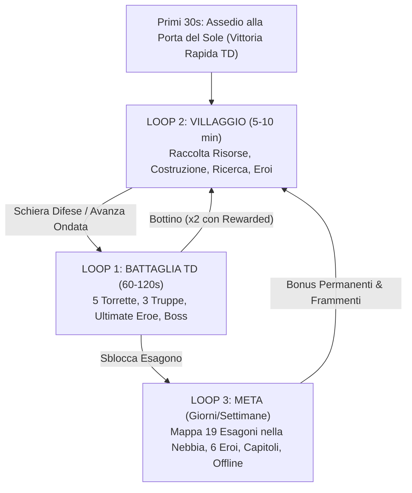

# Game Design Document (GDD) — "Downfall" (L'Assedio dell'Alba)

**Versione:** 1.1 (Tappa T1 — Titolo confermato: **Downfall** + Architettura Clean-Room 1:1)  
**Target Piattaforme:** Playgama, YouTube Playables, Portali Web Mobile & Desktop (iOS Safari / iPhone 16 Pro Max, Android mid-range, Desktop Browser)  
**Stack Tecnologico:** Phaser 4.2.1 (WebGL RenderNodes & Filters) + TypeScript + Vite + Playgama Bridge SDK (v2.3.1)  
**Specifica Tecnica 1:1 Clean-Room:** Vedi [KINGSHOT_CLEANROOM_LOGIC.md](file:///c:/Users/simon/Downloads/Dawnwall/docs/KINGSHOT_CLEANROOM_LOGIC.md)

---

## 1. Titolo Confermato & Nomi Originali Valutati

Titolo confermato per lo sviluppo: **DOWNFALL** (*Downfall: L'Assedio dell'Alba* / *Downfall: Siege of the Dawn*).  
Alternative originali valutate in T0: **Solwark**, **Pyrebastion**, **Mistwark**.

---

## 2. Riferimento di Mercato & Conversione da IAP a Rewarded Ads

Il gioco adotta l'architettura psicologica e di retention di **Kingshot** (Century Games), **Whiteout Survival** e **Last War** — senza mai copiare nomi, personaggi, icone, layout proprietari o testi — applicandola a un universo originale fantasy-solare:

| Pilastro strutturale | Implementazione nel nostro gioco |
| :--- | :--- |
| **Vittoria nei primi 30 secondi** | Avvio *in medias res* senza menu iniziale: la Nebbia attacca la Porta del Sole. Il giocatore tocca 2 slot luminosi per piazzare le prime torrette, schiera i Lancieri e attiva l'abilità suprema di Ser Kaelen in slow-motion, vincendo in **~25 secondi** con esplosione di monete prima che la Nebbia arretri svelando il Villaggio. |
| **Numero "Potenza" (`⚡ POWER`)** | Sempre visibile in alto al centro dentro lo scudo dorato. Ogni costruzione, potenziamento, ricerca, livello eroe, stella o esagono liberato fa scorrere il contatore verso l'alto con un banner verde flottante (`+240 POTENZA!`) e un breve effetto glow. |
| **Obiettivo sempre in vista** | Barra **Missioni a Capitoli** ancorata sopra la pulsantiera del pollice. Un tocco porta direttamente all'edificio o alla battaglia richiesta; una volta completata, brilla in oro per la riscossione immediata. |
| **Timer sfalsati e tetti risorse** | Costruzioni di pochi secondi nella Sessione 1 (con completamento gratuito sotto i 45s), poi minuti e ore. Le 3 strutture produttive accumulano risorse fino a un **tetto massimo** (2–4 ore di capacità nei primi livelli), spingendo il giocatore a rientrare per svuotare i magazzini. |
| **Mappa esagonale nella Nebbia** | 19 territori esagonali concentrici avvolti dalla Nebbia viola-ottanio. Ogni esagono liberato con una battaglia dissolve la Nebbia con uno shader `FilterWipe` + particelle dorate e sblocca bonus permanenti, reliquie o nuovi eroi. |
| **Pallini rossi (`Red Dots`)** | Indicatori pulsanti su ogni azione disponibile (forziere gratuito pronto, missione riscuotibile, edificio potenziabile, eroe promuovibile). |

### Verifica Playgama Checklist & YouTube Playables sui Formati Pubblicitari
Dalla verifica sulla documentazione live di **Playgama Bridge SDK v2** (`wiki.playgama.com`) e della **Game Checklist**:
1. **Formati ammessi e supportati su Playgama e YouTube Playables:**
   - **Rewarded Ads (`bridge.advertisement.showRewarded`)**: Supportate sia su `playgama` che su `youtube` (23 piattaforme su 25). Il premio viene erogato **esclusivamente** quando `REWARDED_STATE_CHANGED` emette lo stato `'rewarded'` (mai su `'closed'` o `'failed'`).
   - **Interstitial Ads (`bridge.advertisement.showInterstitial`)**: Supportate sia su `playgama` che su `youtube`. Mostrate **solo nelle pause naturali** (ritorno dalla Battaglia al Villaggio a partire dall'Ondata 3+), mai nei primi 3 minuti (`initialInterstitialDelay: 180`), con intervallo minimo di 90 secondi (`minimumDelayBetweenInterstitial: 90`) e mai subito dopo che il giocatore ha guardato volontariamente una Rewarded.
   - **Banner Ads (`showBanner`)**: La documentazione ufficiale Playgama conferma che i banner **non sono supportati** su `playgama` né su `youtube` (e ruberebbero spazio verticale prezioso). Pertanto non riserviamo spazio morto per banner statici.
2. **Conformità alla Regola 14 della Checklist Playgama (Divieto di "+1 Vita" bloccante):**
   - La checklist Playgama vieta di bloccare il proseguimento dietro una pubblicità o offrire banalmente "+1 vita" a ogni perdita.
   - **Soluzione progettuale in caso di Sconfitta:** Il pulsante **"Ricomincia Ondata"** è sempre gratuito e immediato. Accanto ad esso, una volta per battaglia, compare il pulsante facoltativo Rewarded **"🎬 Rinforzi dell'Alba (Continua)"**, chiaramente etichettato, che ripara il 50% delle Mura, schiera una carica di Cavalleria Solare d'élite e azzera il cooldown dell'Eroe per ribaltare la battaglia.
3. **I 6 Punti Rewarded (100% facoltativi e ad alto valore percepito):**
   - **Rinforzi dell'Alba (Continua)** in caso di sconfitta in battaglia (max 1x per tentativo).
   - **Bottino Raddoppiato (×2)** nella schermata di Vittoria a fine ondata.
   - **Accelerazione Cantiere / Ricerca** (`-30 minuti` o `-50%` del tempo residuo).
   - **Forziere del Sole Extra** nella Taverna degli Eroi (frammenti eroe + risorse).
   - **Raddoppio Guadagni Offline (×2)** nel popup *"Mentre eri via…"* al rientro.
   - **Benedizione della Fornace Solare** (`+50%` velocità produzione risorse del villaggio per 15 minuti).

---

## 3. I Tre Loop di Gioco

### LOOP 1 – BATTAGLIA (60–120 secondi)
- **Campo di Battaglia Verticale (2.5D Isometrico):** I mostri della Nebbia emergono dalla cortina viola-ottanio nella parte alta dello schermo e avanzano lungo 1 o 2 sentieri lastricati verso le **Mura del Baluardo** in basso.
- **5 Archetipi di Torrette (su slot predefiniti lungo i sentieri):**
  1. **Balista d'Ambra (Arcieri):** Cadenza rapida (1.8 colpi/s), bersaglio singolo, ottima contro corridori e unità volanti.
  2. **Bombarda di Bronzo (Cannone):** Colpi pesanti con 65% perforazione armatura e piccolo danno d'impatto.
  3. **Spira Arcana Solare (Magia):** Raggio prismatico che rimbalza su 2 bersagli e ignora il 100% dell'armatura fisica.
  4. **Obelisco di Brina (Ghiaccio rallentante):** Impulso criogenico ad area che rallenta i nemici del 35%→55% per 2.5s.
  5. **Mortaio Cenerino (Artiglieria ad area):** Gittata lunghissima, esplosione ampia contro gli sciami e terreno incendiato (DoT).
  - *Priorità di tiro selezionabile con un tocco:* `Primo` (default), `Più Forte`, `Più Vicino`, `Ultimo`.
- **3 Archetipi di Truppe (schierabili con un tocco dalla barra inferiore):**
  1. **Guardie dello Scudo (Fanteria):** Avanzano sul sentiero e ingaggiano i nemici in mischia, bloccandoli nel raggio delle torrette.
  2. **Balestrieri del Faro (Arcieri):** Squadra di supporto a distanza posizionata dietro i fanti.
  3. **Lancieri Solari (Cavalleria):** Carica veloce lungo la corsia che infligge danno d'urto e respinge (`knockback`) la prima linea nemica.
- **Abilità Attiva dell'Eroe:** Pulsante dorato prominente in basso; scatena l'abilità suprema dell'eroe leader con freeze-frame di 60ms (`hit-stop`), zoom/shake morbido della camera e particelle dedicate.
- **Ritmo Ondate & Boss:** Un mini-boss (*Campione del Velo*) ogni **5 ondate**; un Boss Maggiore (*Araldo dell'Eclissi*) ogni **10 ondate** con **musica orchestrale dedicata**, avviso visivo rosso-oro e forziere garantito.
- **Game Feel ("Juice"):** Numeri di danno con codice colore (bianco = normale, oro grande con pop `Back.easeOut` = critico, ciano = rallentamento), scossa della camera basata su decadimento quadratico del *trauma*, monete d'oro che volano con traiettoria curva verso il contatore in alto, e **rallentatore cinematografico (0.35× per 0.8s) sull'uccisione dell'ultimo nemico dell'ondata**.

### LOOP 2 – VILLAGGIO (5–10 minuti)
- **La Rocca del Sole (Municipio, Lv. 1–10):** Determina il livello massimo degli altri edifici e l'intensità del Faro Solare che tiene lontana la Nebbia.
- **8 Edifici del Villaggio (ciascuno con 3 Aspetti Visivi distinti: Tier 1 Legno/Tende Lv.1–3, Tier 2 Pietra/Cobalto Lv.4–6, Tier 3 Bronzo Dorato/Cristalli Solari Lv.7–10):**
  1. **Rocca del Sole (Municipio)** — Sblocca edifici, funzionalità e anelli della mappa esagonale.
  2. **Fattoria Solare** — Produce **Cibo** fino al tetto di stoccaggio (tocco sull'icona flottante per raccogliere con volo di risorse verso l'HUD).
  3. **Segheria di Bosco Caldo** — Produce **Legno** fino al tetto di stoccaggio.
  4. **Miniera delle Vene d'Oro** (sbloccata al Municipio Lv.2) — Produce **Pietra** e **Oro**.
  5. **Caserma della Guardia** — Sblocca e potenzia Fanteria, Arcieri e Cavalleria (+18%→+350% statistiche).
  6. **Officina delle Torrette** — Potenzia permanentemente il danno e la cadenza dei 5 archetipi di torretta.
  7. **Mura del Baluardo** — Aumenta gli HP della barriera in battaglia (da 1.000 a 24.500 HP) e sblocca fino a 10 slot torretta.
  8. **Accademia della Luce** (Municipio Lv.3) — Albero di ricerca tecnologica a 3 rami (*Raccolto & Costruzione*, *Balistica & Mura*, *Comando & Spedizione*).
  9. **Taverna degli Eroi** (Municipio Lv.2) — Apertura Forzieri del Sole (1 gratuito ogni 4h→2h + extra via Rewarded), evocazione con frammenti e potenziamento eroi.
- **Feedback Costruzione:** Quando un edificio sale di livello, esegue un'animazione "squash & stretch" (`scaleX: 1.22, scaleY: 0.82` → `Back.easeOut` a `1.0`), sprigiona un anello di particelle dorate e mostra il banner `+POTENZA`.

### LOOP 3 – META (Giorni e Settimane)
- **Mappa del Territorio a 19 Esagoni:** Divisa in 3 anelli concentrici attorno alla Rocca del Sole. Ogni esagono mostra la Potenza consigliata e la ricompensa visibile sopra la Nebbia. Vincendo la battaglia associata, la Nebbia si dissolve rivelando foreste d'ambra, antiche rovine, vene d'oro o santuari che conferiscono **bonus passivi permanenti** (es. `+10% Produzione Legno`, `+15% HP Mura`, sblocco di *Lyra*).
- **6 Eroi Collezionabili al Lancio:**
  1. **Ser Kaelen** *(Raro, Difensore — Sbloccato all'inizio)*: Abilità *Giudizio dell'Alba* (schianto ad area + stordimento 1.5s); Passiva: `+HP Truppe e Mura`.
  2. **Lyra Ventodambra** *(Raro, Maestra Balestriera — Sbloccata all'Esagono 5)*: Abilità *Pioggia di Dardi Solari* (raffica ad area + `+25%` velocità d'attacco torrette per 6s); Passiva: `+Danno Torrette Arcieri`.
  3. **Mastro Thorne** *(Epico, Arcimago della Brina)*: Abilità *Zero Assoluto* (congela i nemici per 3s + danno magico); Passiva: `+Gittata e Rallentamento Torrette`.
  4. **Nyxara del Velo Infranto** *(Epico, Alchimista Solare — Login Giorno 2)*: Abilità *Fiamma Corrosiva* (riduce l'armatura nemica del 50%); Passiva: `+Produzione Risorse Villaggio`.
  5. **Re Aurelius** *(Leggendario, Sovrano del Sole — Login Giorno 7 / Frammenti)*: Abilità *Supernova Reale* (danno massivo su tutto il sentiero + cura il 15% delle Mura); Passiva: `+Danno Globale e Oro`.
  6. **Valkyra Aladorata** *(Leggendario, Comandante Alata)*: Abilità *Carica delle Valchirie* (evoca 4 Lancieri Solari d'élite + onda d'urto); Passiva: `+Probabilità e Danno Critico`.
- **Sistemi di Retention Giornaliera:**
  - **Missioni a Capitoli (Capitoli 1–8):** Guida narrativa e strutturale passo-passo con ricompensa finale di capitolo.
  - **Missioni Giornaliere (5 incarichi rapidi):** Completare 2 battaglie, raccogliere risorse, potenziare 1 edificio, aprire 1 forziere, usare l'abilità eroe 3 volte.
  - **Calendario Accesso 7 Giorni:** Premi crescenti ogni giorno (Giorno 2: Eroe Epico *Nyxara*; Giorno 7: Eroe Leggendario *Re Aurelius*).
  - **Guadagni Offline ("Mentre eri via…"):** Calcolo automatico basato sul timestamp salvato in Bridge Storage (fino a 8 ore di accumulo), con pulsante per incassare subito o **Raddoppiare (×2) tramite Rewarded**.

---

## 4. Architettura Tecnica Phaser 4, Limiti e Lingue

- **Motore:** **Phaser 4** (ultima versione stabile) + TypeScript + Vite.
- **Sfruttamento nativo delle novità di Phaser 4:**
  - **Filters System (`enableFilters()`, `filters.internal` / `filters.external`):** `addGlow` per eroi ed edifici selezionati, `addVignette` per l'atmosfera notturna durante gli assedi, `addWipe` per la dissolvenza della Nebbia sugli esagoni liberati, `ParallelFilters` (Threshold + Blur + Blend ADD) per il bloom solare sui cristalli, `addColorMatrix` per i flash d'impatto.
  - **Tint Modes (`Phaser.TintModes.FILL` / `ADD`):** Hit-flash bianco istantaneo sui nemici colpiti senza duplicare texture.
  - **SpriteGPULayer & Object Pooling:** Pool pre-allocati a zero allocazioni per frame (`EnemyPool`, `ProjectilePool`, `DamageTextPool`, `CoinParticlePool`) e `SpriteGPULayer` per la vegetazione/decorazioni statiche in un'unica draw call.
- **Layout Responsivo & Regola Desktop (Zero Barre Nere):**
  - Base progettata in verticale `9:16` (es. `720×1280` logici) con tutti i controlli interattivi nella metà inferiore per il pollice.
  - Su schermi larghi / Desktop, per rispettare il requisito YouTube Playables (*"Have no black/blur sidebars on the edges of the game in the desktop version"*) e la Checklist Playgama #27, il canvas usa una vista estesa con **cornici scenografiche illustrate in-engine** (bastioni laterali in pietra dorata, stendardi animati e lanterne solari ai lati dell'area di gioco centrale), evitando qualsiasi barra nera o sfocata.
  - Gestione sicura del ridimensionamento anche con viewport `0×0` (`Math.max(1, width)` / guardia sul resize) senza crash WebGL.
- **Rispetto rigoroso dei Budget:**
  - Pacchetto iniziale: **< 5 MiB** (obiettivo: ~2.8–3.8 MiB compressi).
  - Pacchetto totale: **< 15 MiB**.
  - Singolo file: **< 512 KiB** (texture atlas WebP/PNG ottimizzati e audio OGG/MP3 compresso).
  - Tempo di caricamento a `game_ready`: **< 3 secondi** (ben sotto il limite di 5s).
  - Salvataggio Bridge Storage: **< 15 KiB** JSON serializzato e versionato (`version: 1`), salvato in un'unica chiamata `bridge.storage.set(...)` (ben sotto i 500 KiB).
  - Memoria RAM/VRAM: **< 160 MB** (lontano dal tetto di 512 MB).
- **6 Lingue complete (`src/i18n/*.json`):** Inglese (`en`, default e fallback obbligatorio), Italiano (`it`), Spagnolo (`es`), Portoghese (`pt`), Francese (`fr`), Tedesco (`de`), selezionate automaticamente da `bridge.platform.language` all'avvio e modificabili dal menu Impostazioni con nomi nella propria lingua (*English, Italiano, Español, Português, Français, Deutsch*).
