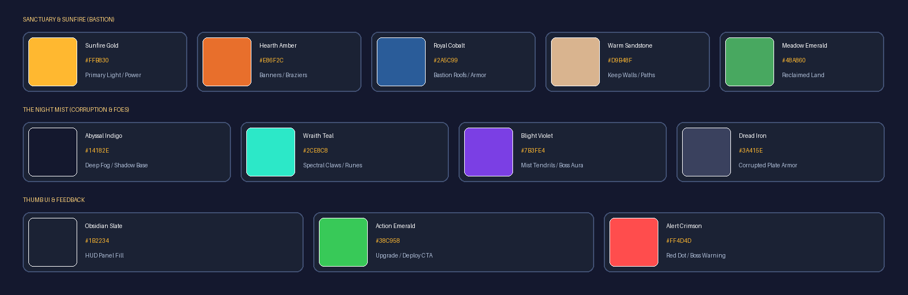
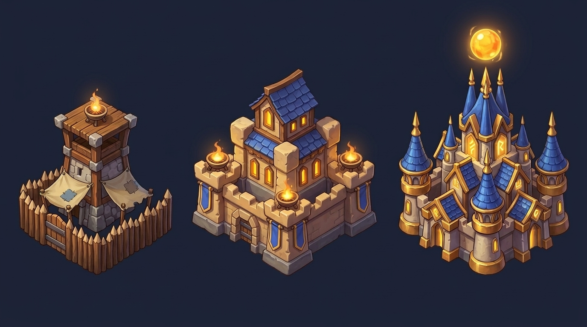
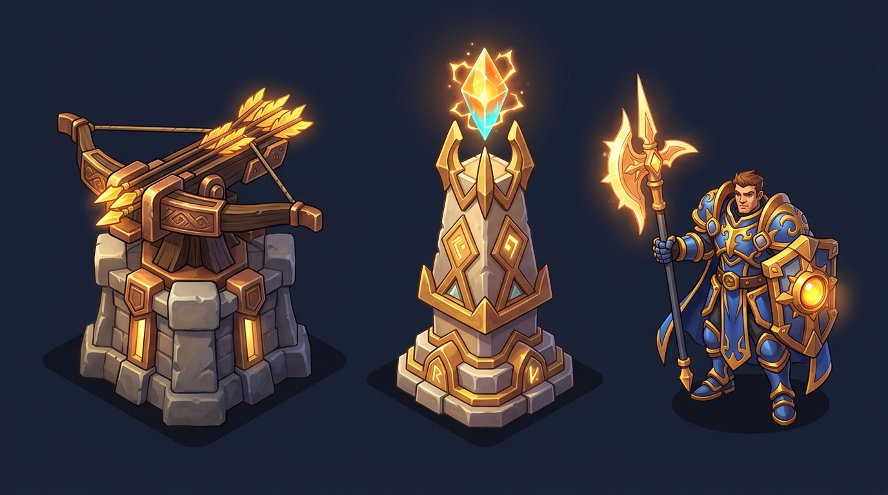
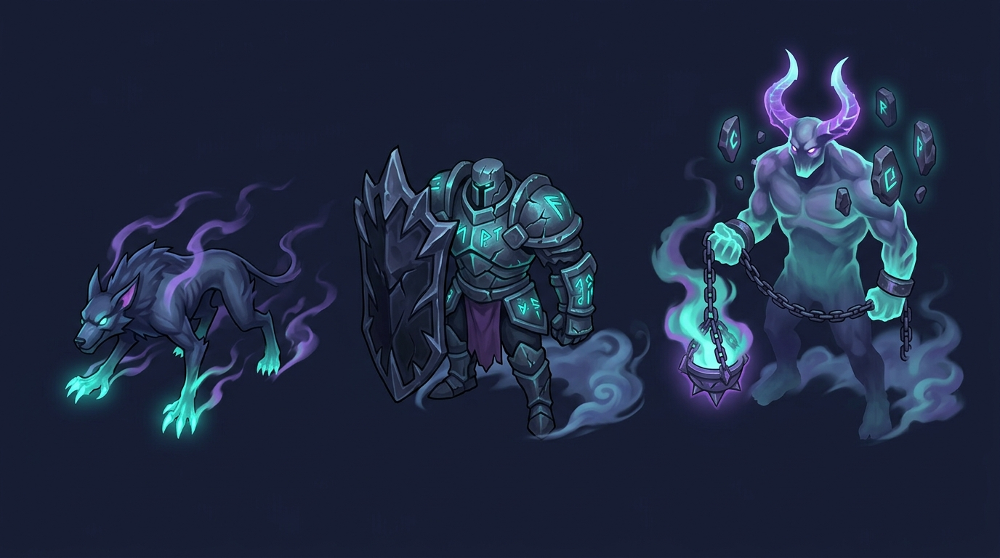
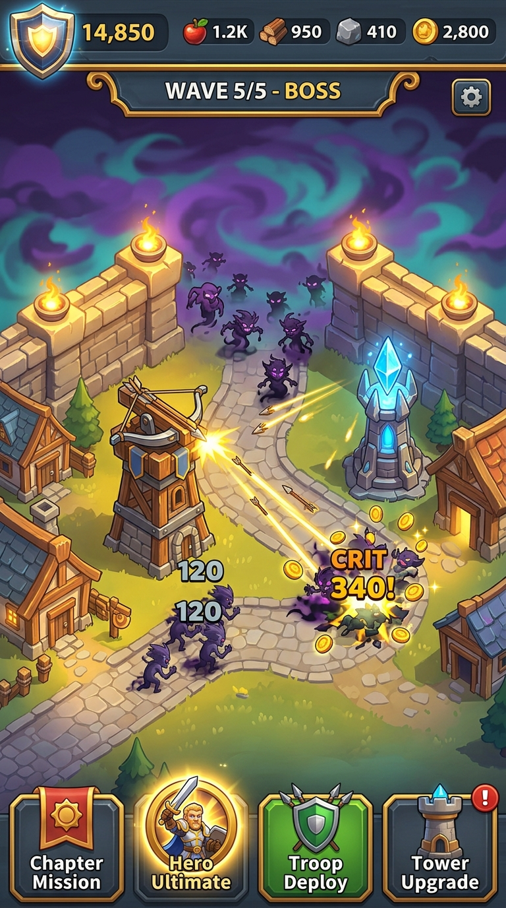

# Tavola di Stile (`STYLE_BOARD.md`)

**Direzione Artistica:** Fantasy cartoon dipinto a mano, colori saturi, luce solare calda contrapposta alla Nebbia notturna viola-ottanio, prospettiva isometrica 2.5D con silhouette spesse e immediatamente leggibili su schermo verticale mobile.

---

## 1. Palette Cromatica Ufficiale

| Gruppo | Nome Colore | Codice HEX | Ruolo Visivo nel Gioco |
| :--- | :--- | :---: | :--- |
| **Bastione Solare** | **Sunfire Gold** | `#FFB830` | Luce primaria dei bracieri, cristalli solari, scudo Potenza, colpi critici |
| **Bastione Solare** | **Hearth Amber** | `#E86F2C` | Tetti caldi, stendardi, bagliori di fuoco e transizioni di livello |
| **Bastione Solare** | **Royal Cobalt** | `#2A5C99` | Tegole dei tetti Lv.2–3, armature delle truppe alleate e di Ser Kaelen |
| **Bastione Solare** | **Warm Sandstone** | `#D9B48F` | Mura del Baluardo, lastricato dei sentieri, basamenti delle torrette |
| **Bastione Solare** | **Meadow Emerald** | `#48A860` | Territori esagonali liberati dalla Nebbia, alberi e campi della Fattoria |
| **La Nebbia Notturna** | **Abyssal Indigo** | `#14182E` | Sfondo profondo della Nebbia inesplorata e ombre ambientali |
| **La Nebbia Notturna** | **Wraith Teal** | `#2CE8C8` | Artigli spettrali, rune corrotte, occhi dei mostri e proiettili nemici |
| **La Nebbia Notturna** | **Blight Violet** | `#7B3FE4` | Volute di Nebbia, corna e aura dei Boss dell'Eclissi |
| **Interfaccia (HUD)** | **Obsidian Slate** | `#1B2234` | Pannelli HUD smussati ad alto contrasto con bordatura oro/acciaio |
| **Interfaccia (HUD)** | **Action Emerald** | `#38C958` | Pulsanti primari d'azione (Potenzia, Costruisci, Schiera Truppe) |
| **Interfaccia (HUD)** | **Alert Crimson** | `#FF4D4D` | Pallini rossi di notifica (`Red Dots`) e avviso arrivo Boss |

---

## 2. Evoluzione Edificio in 3 Livelli: Rocca del Sole (Municipio)

- **Sinistra — Tier 1 (Livelli 1–3, Avamposto del Faro):** Palizzata in legno grezzo, base in pietra rustica, tendoni rattoppati e piccolo braciere di bronzo sulla cima.
- **Centro — Tier 2 (Livelli 4–6, Rocca di Pietra Calda):** Mura merlate in arenaria scolpita, tetti in ardesia blu cobalto, finestre illuminate da luce calda, doppi bracieri solari e stendardi reali.
- **Destra — Tier 3 (Livelli 7–10, Cittadella Solare):** Maestosa fortezza rivestita in bronzo dorato, guglie cobalto, rune solari incandescenti e il grande **Cristallo del Sole** levitante sulla torre centrale.

---

## 3. Difese & Eroe: 2 Torrette + 1 Eroe Giocabile

- **Sinistra — Torretta 1 (*Balista d'Ambra*):** Torretta balestriera in legno rinforzato e bronzo su bastione di pietra, armata con dardi piumati d'oro incandescente (alto rateo di fuoco).
- **Centro — Torretta 2 (*Spira Arcana Solare*):** Obelisco in pietra scolpita e oro sormontato da un prisma levitante ambra-ciano che canalizza raggi perforanti.
- **Destra — Eroe 1 (*Ser Kaelen, Guardiano dell'Alba*):** Capitano paladino in armatura pesante blu cobalto e oro brunito, armato di **Alabarda del Sole** e **Scudo-Lanterna** che irradia luce protettiva.

---

## 4. Minaccia: 3 Archetipi Nemici della Nebbia

- **Sinistra — Nemico Veloce (*Predone della Nebbia / Mist Stalker*):** Segugio d'ombra agile e ricurvo, avvolto da spire viola e dotato di artigli luminescenti color ottanio (`#2CE8C8`).
- **Centro — Nemico Corazzato (*Corazzato del Velo / Veil Dreadguard*):** Guerriero colossale in armatura nera spaccata da rune ottanio, protetto da un massiccio scudo torre d'ossidiana.
- **Destra — Boss (*Araldo dell'Eclissi / Herald of the Eclipse*):** Titano spettrale con corna viola incandescenti, monoliti runici orbitanti e un gigantesco incensiere incatenato che sprigiona la Nebbia corruttrice.

---

## 5. Schermata di Interfaccia Verticale (9:16 Thumb-Friendly)

- **Fascia Superiore:** Scudo dorato con contatore **Potenza (`14,850`)**, indicatori compatti delle 4 risorse (`Cibo`, `Legno`, `Pietra`, `Oro`), barra d'avanzamento dell'ondata (`WAVE 5/5 - BOSS`) e pulsante Impostazioni/Audio.
- **Centro (Campo 2.5D):** Le Mura illuminate dai bracieri caldi tengono a bada la Nebbia viola-ottanio; le torrette sparano lungo il sentiero con numeri di danno leggibili (`120`, `CRIT 340!`) e monete che volano.
- **Fascia Inferiore (Zona Pollice):** Pulsanti grandi, bombati e reattivi: **Missione a Capitoli**, **Abilità Suprema Eroe** (al centro-sinistra con halo dorato), **Schiera Truppe** (verde) e **Potenzia Torrette** con **Pallino Rosso (`!`)**.
